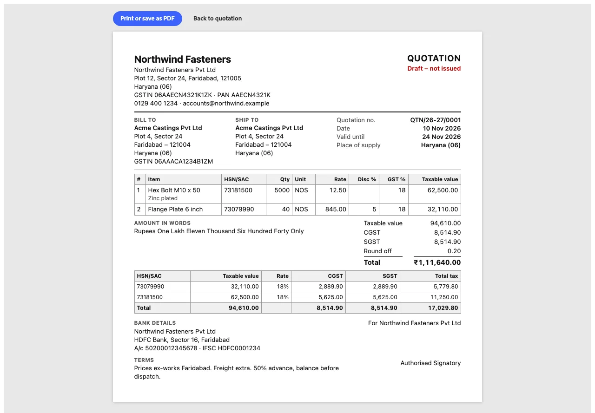
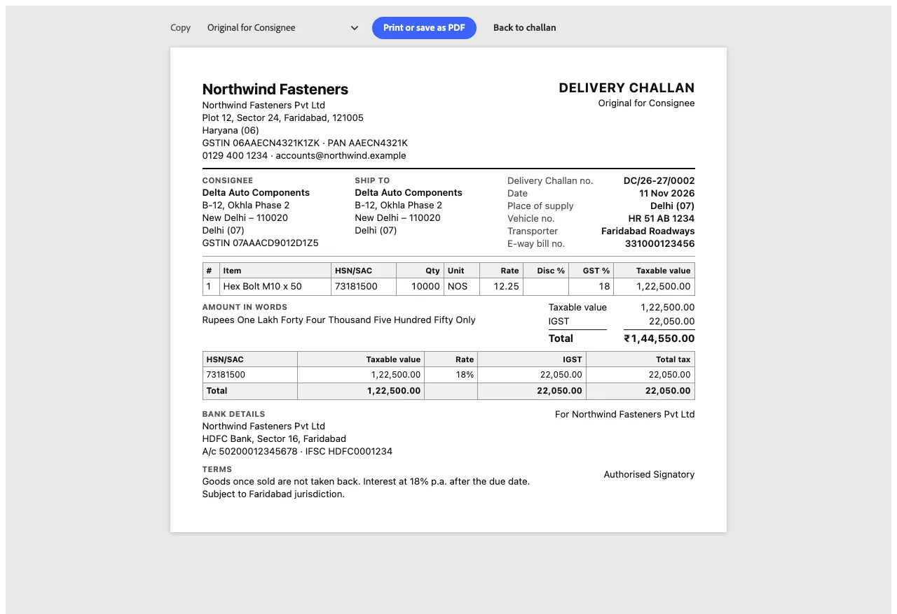
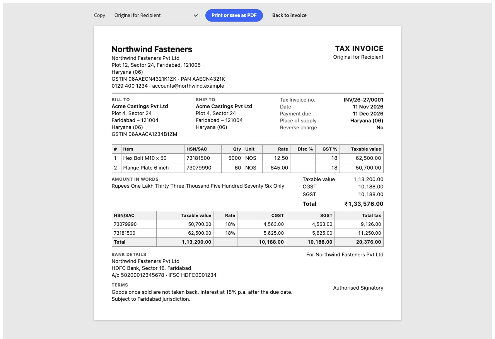
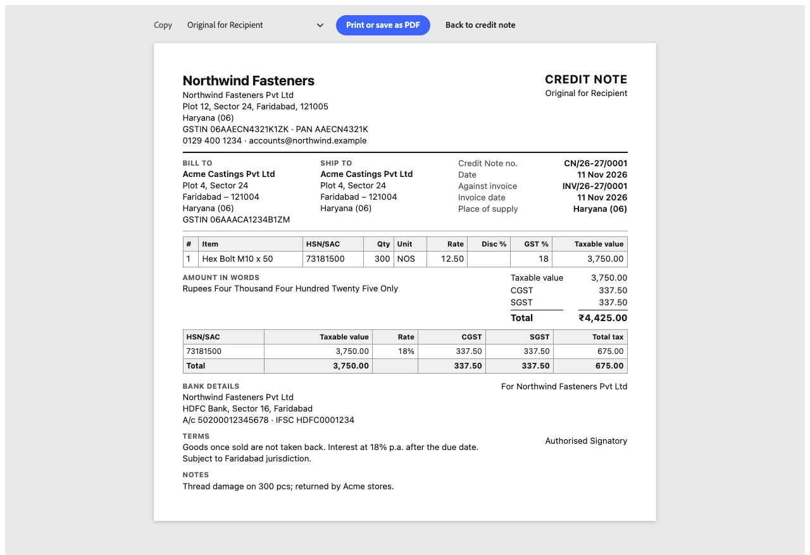
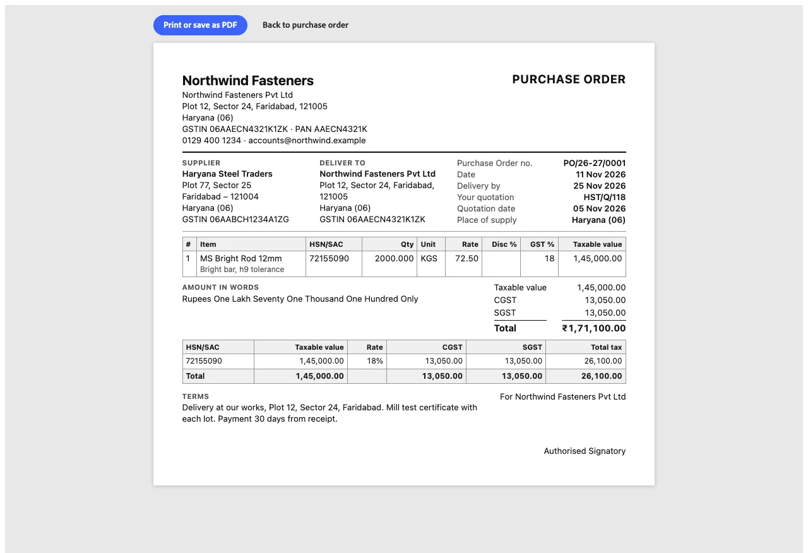

# Print sheets

Every document prints on A4 from its **Print** button. The sheet opens on its own page, outside the app shell,
with a small toolbar: which **copy** it is (Original for Recipient, Duplicate for Transporter, Triplicate for
Supplier), **Print or save as PDF**, and back. The sheet is plain black on white with no theme, so the browser's
"Save as PDF" gives a clean file, and it carries everything GST rules ask for (CGST Rules 46, 53 and 55).

Each sheet has the letterhead (logo, name, address, GSTIN, PAN, contact), Bill to and Ship to, the document's
details on the right, the lines, totals with the **amount in words**, an **HSN/SAC tax summary**, bank details
(on sales documents), terms, and "For *the company* / Authorised Signatory". Long documents run over several pages,
and the lines' header row repeats on each.

Print sheets are shown in light, desktop only: they are paper.

## Quotation

*Desktop · 1280 px · light*

## Delivery challan

Titled by its type ("Delivery Challan", "Job Work Challan"), with transport details and in triplicate.

*Desktop · 1280 px · light*

## Tax invoice

*Desktop · 1280 px · light*

## Credit note

It names the invoice it's against, with that invoice's date.

*Desktop · 1280 px · light*

## Purchase order

To the supplier: **Deliver to** is the factory's own address, and there are no bank details.

*Desktop · 1280 px · light*

