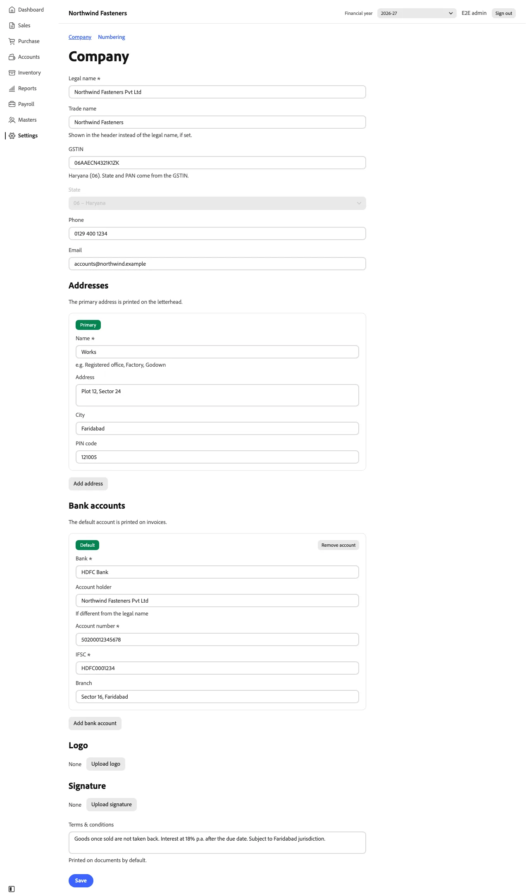
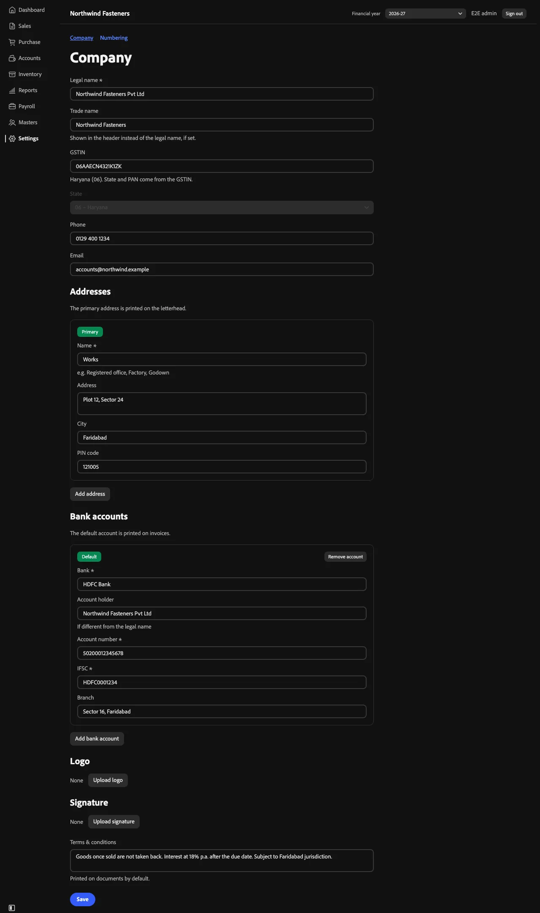
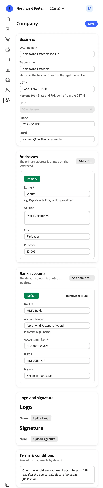
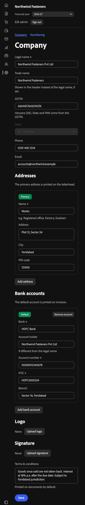
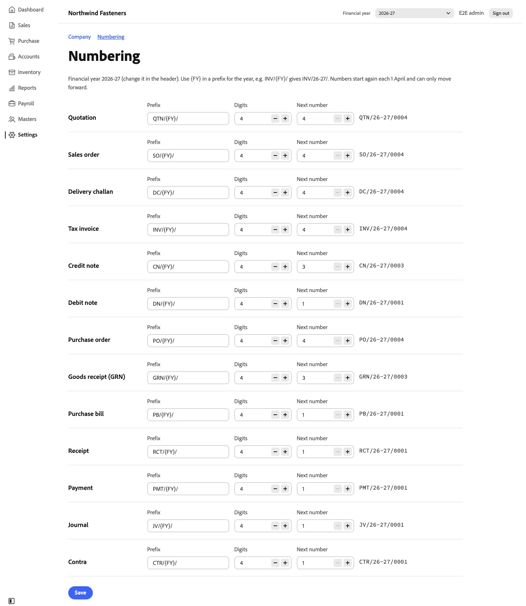
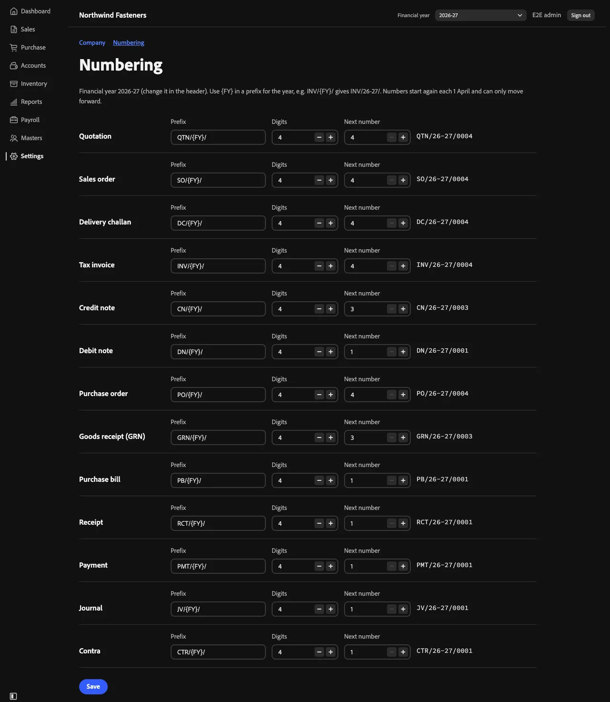
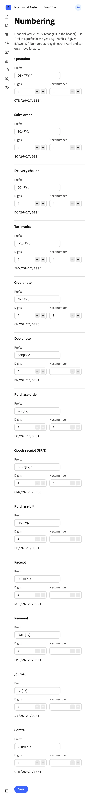
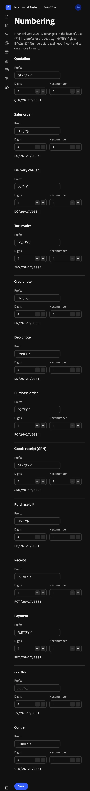

# Settings

Admins edit settings; everyone else reads them.

## Company

**Settings → Company.** The profile printed on every document and shown in the header: legal and trade name,
GSTIN (fills state and PAN), phone, email, **logo** and **signature** images, default terms, **addresses** (one
marked primary, the registered office) and **bank accounts** (one default, printed on invoices).

*Desktop · 1280 px · light*

*Desktop · 1280 px · dark*

| Phone · 390 px · light | Phone · 390 px · dark |
|---|---|
|  |  |

## Numbering

**Settings → Numbering.** One row per document type for the financial year chosen in the header: **prefix**
(`{FY}` becomes 26-27), **digits** (zero padding) and **next number**, with a live preview of the next number on the
right (INV/26-27/0004). Numbers restart each 1 April and can only move forward, so the field won't go below
what's been used.

*Desktop · 1280 px · light*

*Desktop · 1280 px · dark*

| Phone · 390 px · light | Phone · 390 px · dark |
|---|---|
|  |  |
