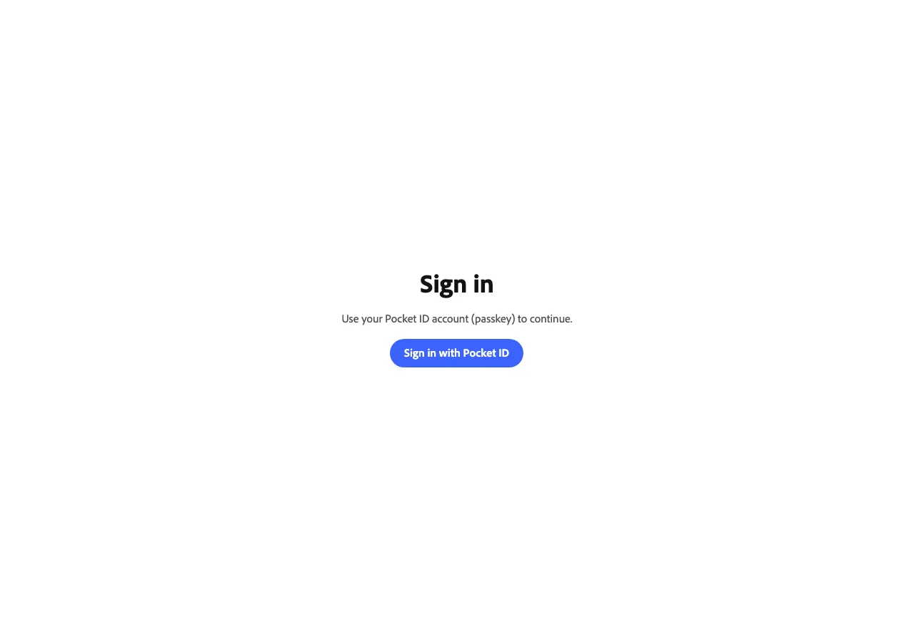
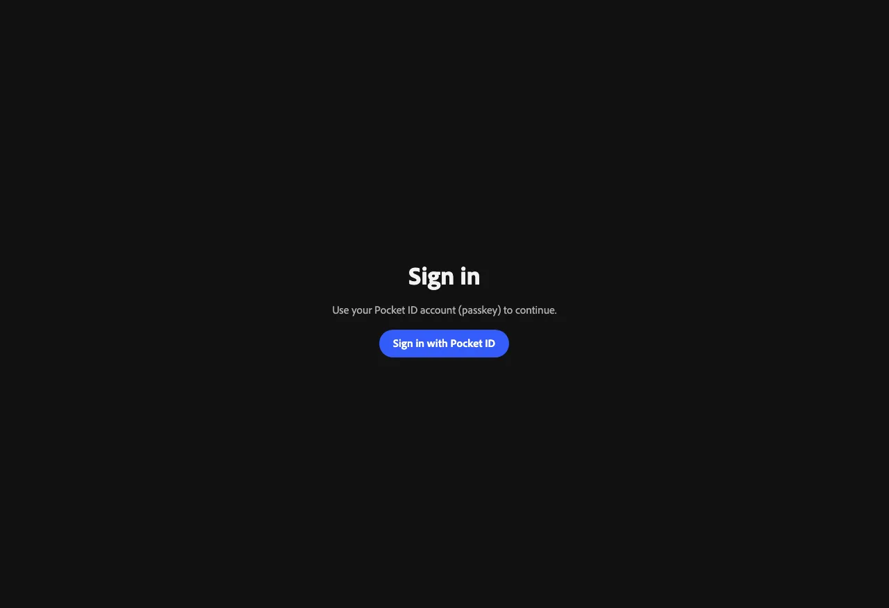
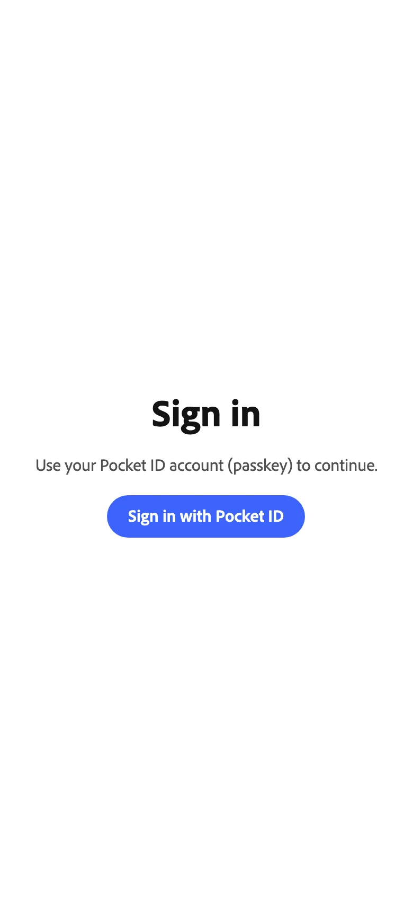
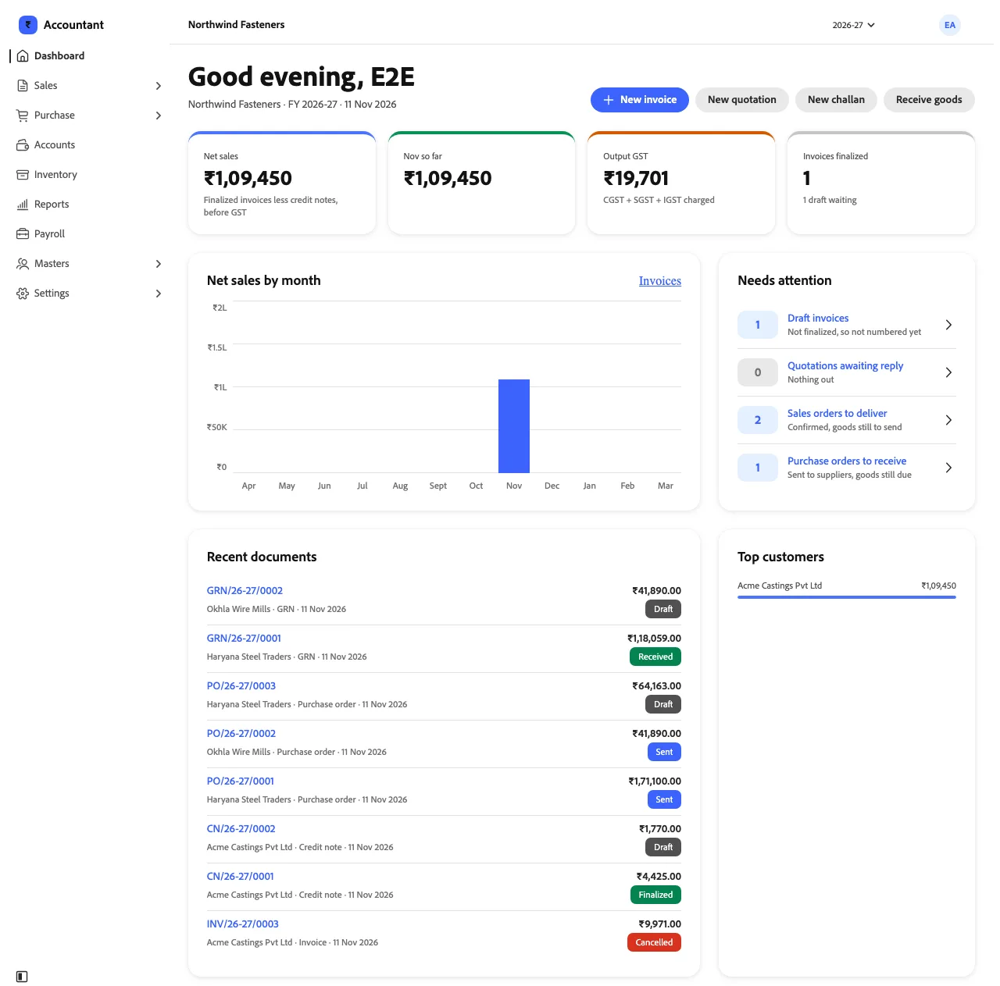
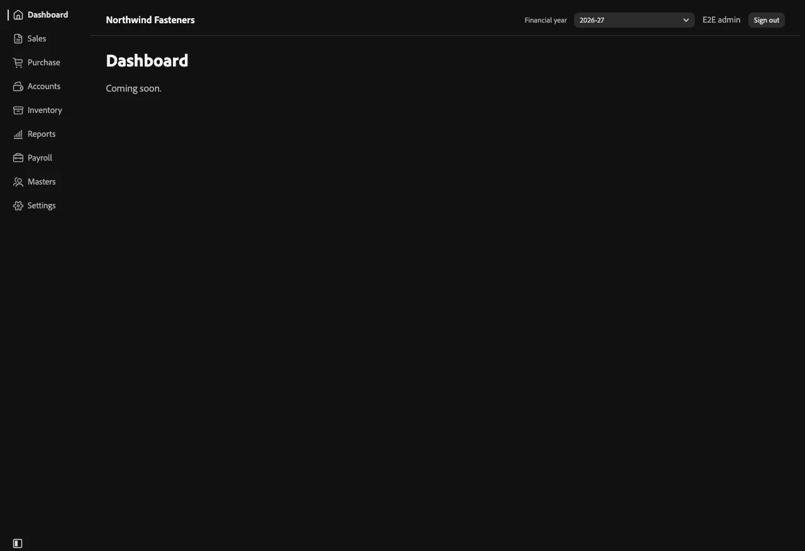
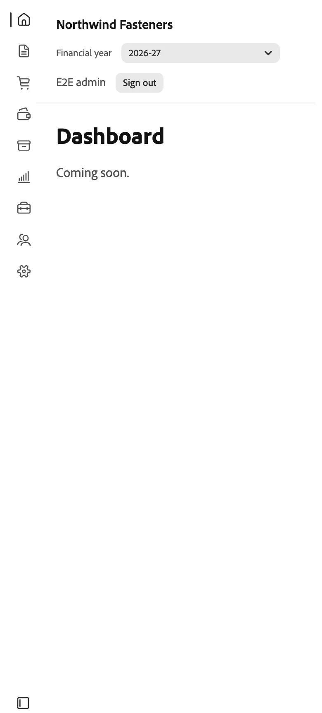
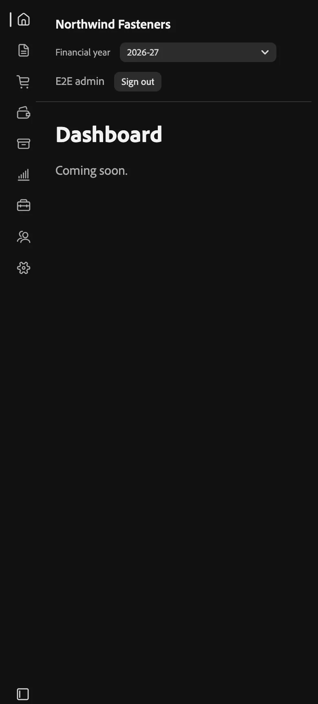
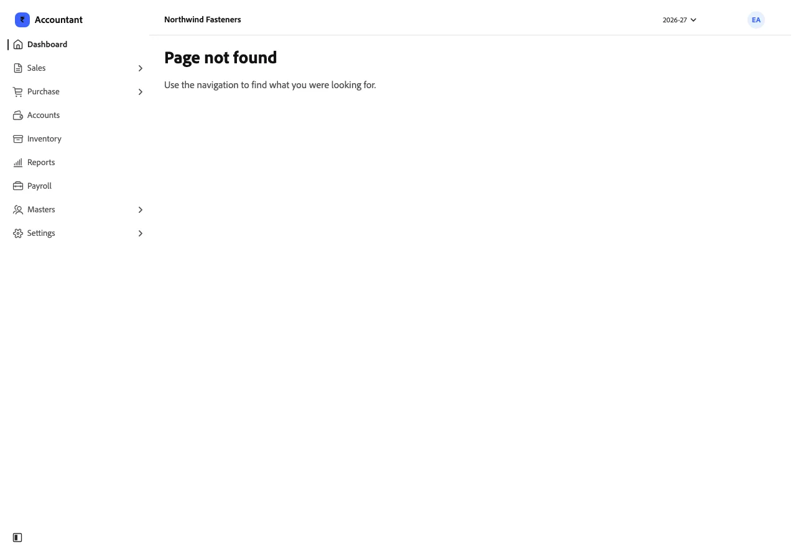
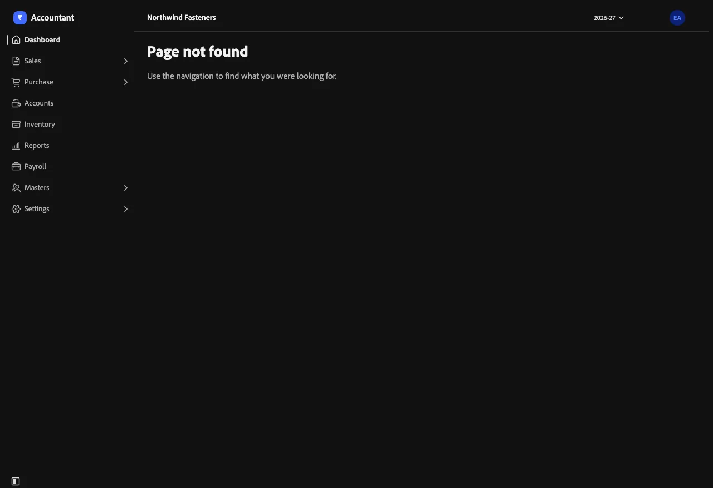

# App shell

The frame around every screen: a side navigation on the left and a header across the top. Print sheets and
the sign-in page are the only screens outside it.

## Sign-in

Shown to anyone who isn't signed in. Sign-in goes through Pocket ID (the company's passkey login), so this page
has a single button. Someone Pocket ID knows but who has no role in the app sees a "no access" page of the
same shape.

*Desktop · 1280 px · light*

*Desktop · 1280 px · dark*

| Phone · 390 px · light | Phone · 390 px · dark |
|---|---|
|  |  |

## Header and side navigation

- **Side navigation** (left): the app's mark, then Dashboard, Sales, Purchase, Accounts, Inventory, Reports,
  Payroll, Masters and Settings, each with an icon. A section with pages opens to them (Sales › Quotations ·
  Orders · Challans · Invoices · Credit notes); the current section opens itself, and the current page has a
  bar and bold text. The button at the bottom left collapses it to icons only; on a phone it starts collapsed.
- **Top bar** (slim, 48 px): the company's trade name, the **Financial year** picker (April to March; every list,
  number series and the dashboard follow it), and the user's **avatar** (initials). The avatar opens a popover
  with their name, role and email, and **Sign out**.
- Accounts, Inventory, Reports and Payroll aren't built yet and show "Coming soon".

## Dashboard

The first screen after sign-in, for the header's financial year (one request, `GET /api/dashboard?fy=`):

- A greeting with the company, FY and date, and quick actions by role: New invoice and New quotation (office),
  New challan and Receive goods (office and floor). Viewers get none.
- Four figures: **net sales** (finalized invoices less finalized credit notes, before GST), **this month so far**
  with the change on last month, **output GST**, and **invoices finalized** with the drafts waiting.
- **Net sales by month**, April to March; hover or focus a bar for its figure.
- **Needs attention**: draft invoices, quotations awaiting a reply, sales orders still to deliver and purchase
  orders still to receive, each linking to its filtered list.
- **Recent documents** of any type, and **top customers** by net sales.

Receivables, payables and low stock join it once accounts and inventory exist.

*Desktop · 1280 px · light*

*Desktop · 1280 px · dark*

| Phone · 390 px · light | Phone · 390 px · dark |
|---|---|
|  |  |

## Page not found

*Desktop · 1280 px · light*

*Desktop · 1280 px · dark*

